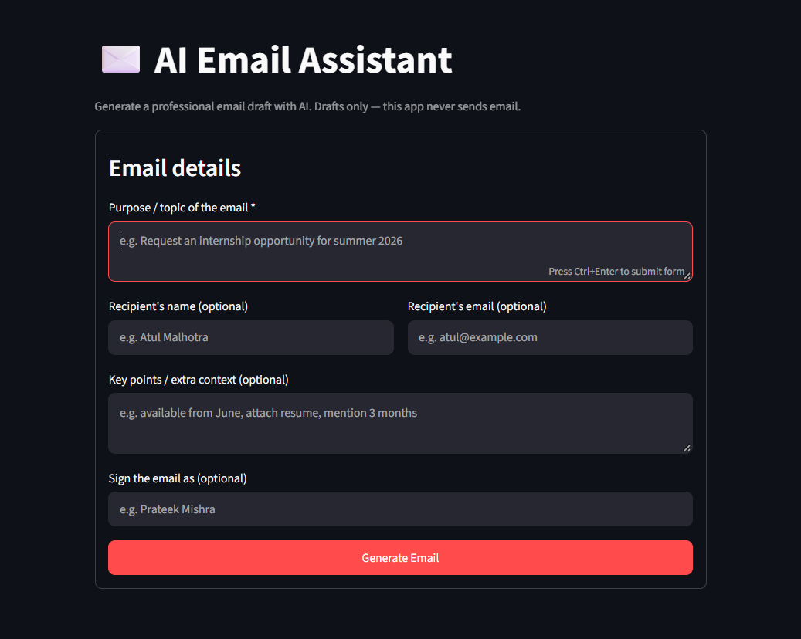
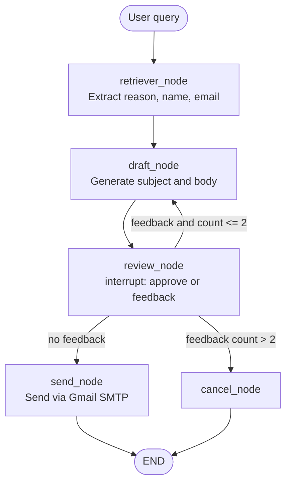
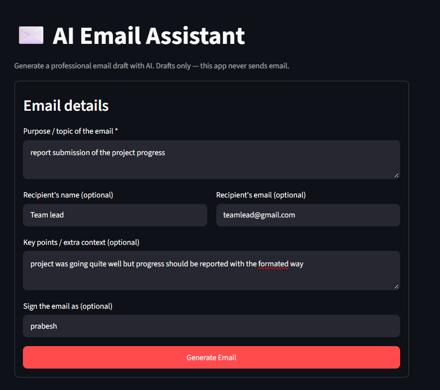
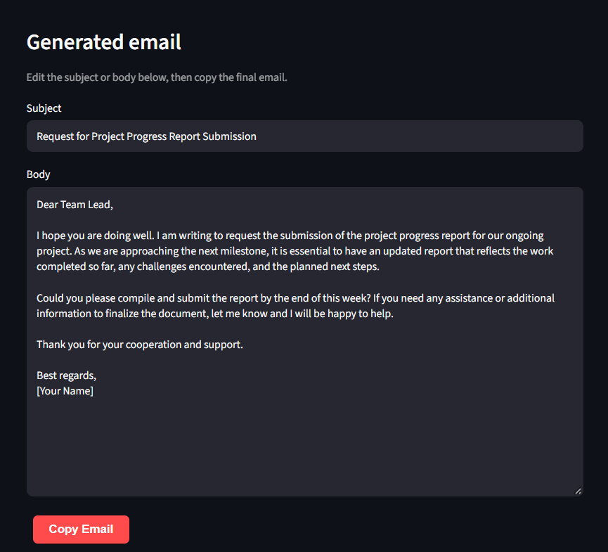
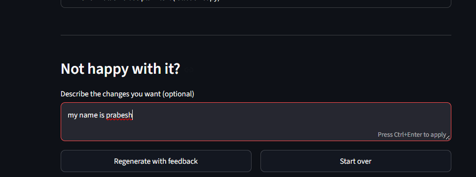
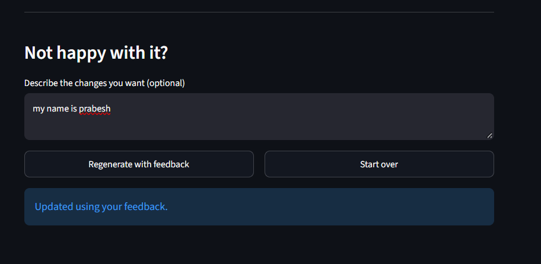
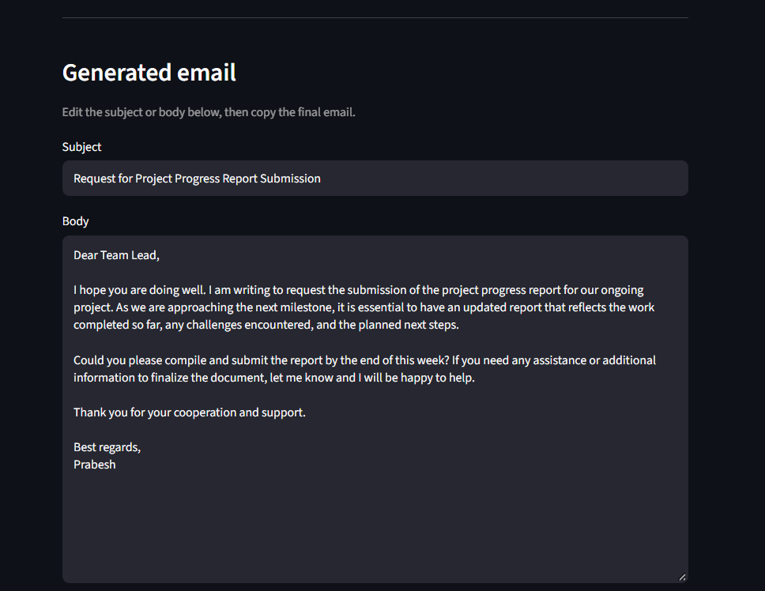

# AI Email Agent


A LangGraph-based email drafting assistant. It takes a natural-language request,
extracts the recipient details with an LLM, drafts a subject and body, and then
**pauses for human review** so the draft can be approved or revised. Drafting and
sending are separate steps; the bundled Streamlit interface only produces drafts.

> Draft vs. send: the underlying agent can send email through Gmail SMTP once a
> draft is approved in the command-line flow. The Streamlit UI is intentionally
> draft-only and never sends anything. See [Security Notes](#security-notes).



---

## Features

Implemented and verifiable from the source:

- **Structured detail extraction** — an LLM with structured output
  (`UserDetails`) pulls the reason, recipient name, and recipient email from the
  request (`agent.py`).
- **Email drafting** — a second structured-output call (`DraftEmail`) produces a
  subject and body. The draft prompt targets a body of up to ~200 words.
- **Human-in-the-loop review** — LangGraph `interrupt()` pauses the graph at
  `review_node` so a human can approve or supply feedback.
- **Revision loop** — feedback re-runs the draft node with the previous
  subject/body and the feedback. After more than two revisions the graph cancels.
- **Optional sending** — on approval the `send_node` calls `send_mail()`
  (`send_email.py`) to send via Gmail SMTP.
- **Streamlit interface** — a form-based UI that generates drafts, lets you edit
  the subject/body, and copy the result. It never resumes with approval, so no
  email is ever sent from the UI.

Not implemented (potential future work):

- Tone or style selection, multiple recipients, CC/BCC, attachments, HTML email.
- Persistent checkpointing (the graph currently uses an in-memory checkpointer).
- Automated tests (only a manual notebook is provided).

---

## Architecture and Workflow

The graph is defined in `agent.py` and compiled as `final_graph`
(`StateGraph(EmailState)` with an in-memory checkpointer).



**State (`EmailState`)** — `question`, `mail_reason`, `recipient_name`,
`recipient_email`, `subject`, `body`, `feedback`, `feedback_count`, `response`.

**Flow**

1. `retriever_node` runs structured extraction over `question` and fills the
   recipient fields.
2. `draft_node` generates `subject` and `body`. If `feedback` is set, it revises
   the existing draft instead of starting over.
3. `review_node` calls `interrupt()`. Resuming with `"yes"` clears the feedback;
   any other reply is treated as feedback and increments `feedback_count`.
4. `router` decides the next step: no feedback → `send`; feedback with
   `feedback_count <= 2` → `draft`; `feedback_count > 2` → `cancel`.

---

## Technology Stack

| Area | Used |
|------|------|
| Language | Python 3.13 |
| Orchestration | LangGraph (`StateGraph`, `interrupt`, `Command`, `InMemorySaver`) |
| LLM client | LangChain Core + `langchain-groq` (`ChatGroq`, model `openai/gpt-oss-20b`) |
| Data models | Pydantic |
| Config | `python-dotenv` |
| UI | Streamlit |
| Email | Python standard library `smtplib` / `email.message` |

---

## Project Structure

```
01_email_Agent/
├── agent.py          # LangGraph workflow: state, nodes, edges, final_graph
├── send_email.py     # Gmail SMTP helper used by send_node
├── streamlit_app.py  # Streamlit UI (draft-only)
├── test.ipynb        # Notebook used for manual, interactive testing
└── assets/           # README screenshots
    ├── email-form.png
    ├── email-form-filled.png
    ├── email-generated.png
    ├── email-feedback.png
    ├── email-feedback-applied.png
    └── email-generated-updated.png
```

- **`agent.py`** — defines `EmailState`, the retriever/draft/review/send/cancel
  nodes, the router, and the compiled `final_graph`. Running it directly starts
  an interactive command-line loop.
- **`send_email.py`** — `send_mail(recipient_email, subject, body)` sends the
  message over Gmail SMTP.
- **`streamlit_app.py`** — the web interface; imports `final_graph` and calls it
  without re-implementing any workflow logic.
- **`test.ipynb`** — example invocations and observed output for manual testing.

---

## Prerequisites and Installation

- **Python 3.10+** (the project was developed on Python 3.13.5).
- A **Groq API key** (`GROQ_API_KEY`).

The shared dependency list lives at `Agentic_ai/Langraph/requirement.txt`. It
does **not** include Streamlit, so install that separately for the UI.

```powershell
# From Agentic_ai\Langraph\01_email_Agent
python -m venv .venv
.\.venv\Scripts\Activate.ps1

pip install -r ..\requirement.txt
pip install streamlit
```

---

## Environment Configuration

The agents read a `.env` file placed at `Agentic_ai/Langraph/.env`, which is
excluded from Git by the repository `.gitignore`.

**Required**

| Variable | Purpose |
|----------|---------|
| `GROQ_API_KEY` | Authenticates calls to the Groq-hosted model used by the agent. |

**Additionally required to actually send mail:** valid Gmail SMTP credentials.
These are currently **hardcoded** in `send_email.py` rather than read from the
environment (see [Security Notes](#security-notes)). No API key values are
included in this document.

Example `.env` (placeholder only):

```dotenv
GROQ_API_KEY=your_groq_api_key_here
```

---

## Running the Application

Run commands from the `01_email_Agent` directory.

**Command-line agent** (interactive loop; approving a draft sends a real email):

```powershell
python agent.py
```

You type a request, review the printed subject and body, and then either enter
`yes` to approve or type feedback to request a revision. Feedback is applied up
to three times before the graph cancels.

**Streamlit interface** (draft only):

```powershell
streamlit run streamlit_app.py
```

The UI opens in your browser at `http://localhost:8501` by default. Fill in the
email purpose and optional recipient details, click **Generate Email**, edit the
result if needed, and use the copy button to copy the draft. Regenerate with
feedback to iterate, or start over for a new email.

---

## Usage Example

Illustrative input:

```
I want to send a leave request from 12 Oct 2026 to 14 Oct 2026.
My manager's name is "Atul Malhotra" and the email address is
"atul@example.com".
```

Illustrative generated draft (structure only; the actual wording varies by run):

```
Subject: Leave Request: 12-14 October 2026

Dear Atul,

I hope you are well. I am writing to formally request leave from
12 October 2026 to 14 October 2026. During this period I will ensure
that all my responsibilities are covered and will hand over any
pending tasks to the team.

Thank you for your consideration.

Best regards,
[Your Name]
```

The screenshots below show the same workflow in the Streamlit interface. These are
draft-only; no email is sent from the UI.

The form after entering the purpose, recipient, key points, and a signature:



The generated subject and editable body, with a **Copy Email** button:



Providing feedback to revise the draft:



Confirmation that the draft was updated from the feedback:



The revised draft, with the placeholder signature replaced:



---

## Limitations and Future Improvements

**Known limitations (supported by the code):**

- State is kept by an in-memory checkpointer, so conversations do not survive a
  process restart.
- The retriever's guard for missing `mail_reason`/`recipient_email` is a no-op
  (`pass`), so missing details are not actively handled or re-requested.
- The draft quality and structured-output reliability depend on the model; the
  Groq model can intermittently fail to emit a structured tool call, producing a
  `BadRequestError`.
- The Streamlit UI is draft-only by design and does not expose the sending step.

**Possible future improvements:**

- Persist checkpoints with a durable saver.
- Move SMTP credentials to environment variables and add validation.
- Add tone/length options and support for CC/BCC and attachments.
- Add automated tests and clearer input validation.

---

## Security Notes

- **Hardcoded SMTP credentials.** `send_email.py` currently contains a hardcoded
  sender address and app password in a tracked source file. These values are not
  reproduced here. They should be removed from the code, loaded from environment
  variables, and the exposed credential should be rotated.
- **API keys.** `GROQ_API_KEY` is read from the `.env` file, which is ignored by
  Git. Never commit real keys or paste them into issues or screenshots.
- **Draft vs. send.** Generating a draft is safe and local. Actually sending mail
  only happens through the command-line flow when a draft is approved, which
  invokes `send_mail()`. The Streamlit app never sends.
