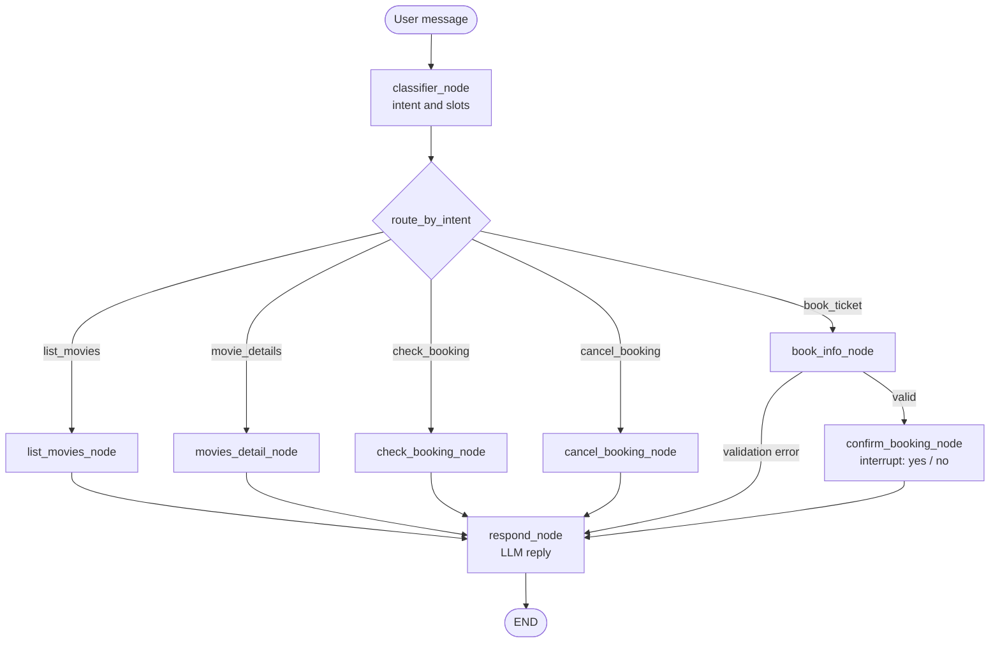

# AI Movie Ticket Booking Agent


A conversational LangGraph agent that handles movie ticket requests: browsing
movies, viewing details, booking seats, checking a booking, and cancelling a
booking. It classifies the user's intent, extracts the relevant details, and
runs the matching database operation, then uses an LLM to phrase a friendly
response.

> Simulated bookings: this project does **not** connect to any real cinema
> system, does **not** process payments, and does **not** reserve or issue real
> tickets. All bookings are stored in a local SQLite file (`cinema.db`). See
> [Booking and Transaction Limitations](#booking-and-transaction-limitations).

---

## Features

Implemented and verifiable from the source:

- **Intent classification and slot extraction** — a structured-output LLM call
  (`ClassifiedIntent`) selects one intent and extracts movie id/title, customer
  name, seats, and booking id (`agent.py`).
- **Movie discovery** — `list_movies_node` returns every movie with id, title,
  genre, show time, price, and available seats.
- **Movie details** — `movies_detail_node` looks up a single movie by id or by
  case-insensitive title match.
- **Booking with validation** — `book_info_node` checks for missing details and
  insufficient seats before proceeding, returning a clear error otherwise.
- **Confirmation step** — `confirm_booking_node` uses LangGraph `interrupt()` and
  writes the booking to SQLite only when resumed with `"yes"`.
- **Booking lookup** — `check_booking_node` returns the status and details of an
  existing booking.
- **Cancellation** — `cancel_booking_node` marks a booking as cancelled and
  returns a simulated refund message.
- **Natural-language replies** — `respond_node` turns the raw result data into a
  readable answer with an LLM.
- **Stateful conversation** — state is kept per `thread_id` with an in-memory
  checkpointer.
- **Streamlit chat interface** — `streamlit_app.py` drives the existing graph,
  shows the confirmation prompt, and lets you answer it.

Declared but not fully wired:

- The classifier's intent set includes `return_tickets` and `general`, but the
  graph defines no nodes or edges for them (see
  [Known limitations](#known-limitations)).

---

## Architecture and Workflow

The graph is defined in `agent.py` and compiled as `final_graph`
(`StateGraph(CinemaState)` with an in-memory checkpointer).



**State (`CinemaState`)** — `user_message`, `intent`, `movie_id`, `movie_title`,
`customer_name`, `seats`, `booking_id`, `total_amount`, `result`, `data`.

**Nodes**

| Node | Responsibility |
|------|----------------|
| `classifier_node` | Classify intent and extract slots via `ClassifiedIntent`. |
| `list_movies_node` | Return all movies from SQLite. |
| `movies_detail_node` | Return one movie by id or title. |
| `book_info_node` | Validate booking inputs and seat availability. |
| `confirm_booking_node` | `interrupt()`; on `"yes"` write the booking and update seats. |
| `check_booking_node` | Look up an existing booking and its movie. |
| `cancel_booking_node` | Mark a booking cancelled and emit a refund message. |
| `respond_node` | Generate the final natural-language reply. |

**Routers** — `route_by_intent` dispatches on the classified intent;
`router_after_book_info` sends validation errors to `respond_node` and valid
requests to `confirm_booking_node`.

---

## Technology Stack

| Area | Used |
|------|------|
| Language | Python 3.13 |
| Orchestration | LangGraph (`StateGraph`, `interrupt`, `Command`, `InMemorySaver`) |
| LLM client | LangChain Core + `langchain-groq` (`ChatGroq`, model `openai/gpt-oss-20b`) |
| Data models | Pydantic |
| Storage | SQLAlchemy ORM over a local SQLite database (`cinema.db`) |
| Config | `python-dotenv` |
| UI | Streamlit |

---

## Project Structure

```
02_booking_agent/
├── agent.py          # LangGraph workflow: state, nodes, edges, final_graph
├── models.py         # SQLAlchemy engine and Movies / Booking tables
├── db.py             # Seed movie data
├── streamlit_app.py  # Streamlit chat UI
├── cinema.db         # Local SQLite database (generated; excluded from Git)
└── test.ipynb        # Notebook used for manual, interactive testing
```

- **`agent.py`** — defines `CinemaState`, the classifier and operation nodes, the
  routers, and the compiled `final_graph`. Importing it also creates the tables
  and seeds the movie list.
- **`models.py`** — the SQLAlchemy `engine` (`sqlite:///./cinema.db`) plus the
  `Movies` and `Booking` models. `Movies.available` is computed as
  `total_seats - booked_seats`.
- **`db.py`** — the initial list of five movies used to seed the database.
- **`streamlit_app.py`** — the web interface; imports `final_graph` and calls it
  without re-implementing the workflow.
- **`test.ipynb`** — example invocations and observed responses.

---

## Prerequisites and Installation

- **Python 3.10+** (the project was developed on Python 3.13.5).
- A **Groq API key** (`GROQ_API_KEY`).

The shared dependency list lives at `Agentic_ai/Langraph/requirement.txt`. It
does **not** include Streamlit, so install that separately for the UI.

```powershell
# From Agentic_ai\Langraph\02_booking_agent
python -m venv .venv
.\.venv\Scripts\Activate.ps1

pip install -r ..\requirement.txt
pip install streamlit
```

The database and its seed data are created automatically the first time
`agent.py` is imported (or when the Streamlit app starts), so no manual database
setup is required.

---

## Environment Configuration

The agent reads a `.env` file placed at `Agentic_ai/Langraph/.env`, which is
excluded from Git by the repository `.gitignore`.

**Required**

| Variable | Purpose |
|----------|---------|
| `GROQ_API_KEY` | Authenticates calls to the Groq-hosted model used for classification and replies. |

No key values are included in this document.

Example `.env` (placeholder only):

```dotenv
GROQ_API_KEY=your_groq_api_key_here
```

---

## Running the Application

Run commands from the `02_booking_agent` directory so that the imports
(`from models import ...`) and the relative SQLite path resolve correctly.

**Streamlit interface (recommended):**

```powershell
streamlit run streamlit_app.py
```

The app opens at `http://localhost:8501` by default. Type a request in the chat
box. When a booking reaches the confirmation step, the agent replies with a
prompt and the next message you type is sent back as the confirmation answer.

**Programmatic use** (as shown in `test.ipynb`):

```python
from agent import final_graph
from langgraph.types import Command

config = {"configurable": {"thread_id": "1"}}

final_graph.invoke({"user_message": "List all the movies"}, config)

# Booking triggers a confirmation interrupt:
final_graph.invoke(
    {"user_message": "I am Prateek and I want to book 2 tickets for Avengers"},
    config,
)
final_graph.invoke(Command(resume="yes"), config)
```

---

## Usage Example

Illustrative interaction (structure only; wording varies by run):

```
User:  What movies are showing?

Agent: Here are the current movies:

       | ID | Title           | Genre  | Show Time | Price | Seats Left |
       |----|-----------------|--------|-----------|-------|------------|
       | 1  | Inception       | Sci-Fi | 7:00 PM   | $15   | 50         |
       | 2  | Interstellar    | Sci-Fi | 8:30 PM   | $15   | 40         |
       | 3  | The Dark Knight | Action | 6:00 PM   | $12   | 60         |
       | 4  | Avengers        | Action | 5:00 PM   | $13   | 80         |
       | 5  | The Godfather   | Drama  | 9:00 PM   | $10   | 30         |

User:  Book 2 tickets for Avengers for Alice.

Agent: Confirm Your Booking ? Yes / No

User:  yes

Agent: Your booking is confirmed.
       Movie: Avengers | Name: Alice | Seats: 2 | Booking ID: 1
```

The final confirmation above is a **simulated** record stored in the local
`cinema.db`; it is not a real reservation.

---

## Booking and Transaction Limitations

Verified from the source — the project does **not**:

- connect to any real cinema, ticketing, or third-party system;
- reserve real seats or issue valid tickets;
- process any payment or refund (refund text is a fixed message).

Bookings, cancellations, and refunds are simulated against a local SQLite file
and are not authoritative.

**Known limitations:**

- `return_tickets` and `general` are declared in `ClassifiedIntent` but have no
  nodes or edges in the graph, so those intents would fail routing if selected.
- Seat accounting is inconsistent: `confirm_booking_node` reduces
  `Movies.total_seats`, while `cancel_booking_node` increases `Movies.booked_seats`.
  Because availability is `total_seats - booked_seats`, cancelling does not
  restore availability as expected.
- State is held by an in-memory checkpointer, so conversation and confirmation
  context do not survive a process restart.
- `CinemaState.data` is an untyped dictionary, so node outputs are not validated
  against a schema.

---

## Future Improvements

- Add graph nodes/edges for the `return_tickets` and `general` intents.
- Fix seat accounting so cancellations restore availability consistently.
- Persist state and bookings with a durable checkpointer and stronger schema
  validation.
- Add automated tests for each intent and the confirmation flow.
- Add seat selection, showtime selection, and a clearer confirmation summary.

---

## Security Notes

- **API keys.** `GROQ_API_KEY` is read from the `.env` file, which is ignored by
  Git. Never commit real keys or share them in screenshots or issues.
- **Local data.** `cinema.db` is a local SQLite file (also excluded by
  `.gitignore`); it is intended for demonstration only and holds no real user
  data.
- **No authentication.** The Streamlit app has no login or access control and is
  designed for local, single-user use.
